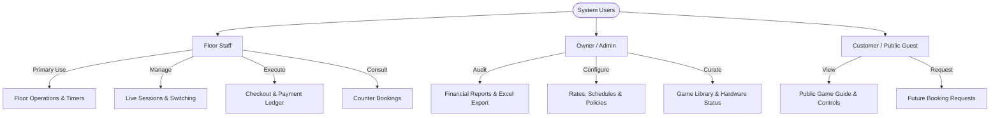
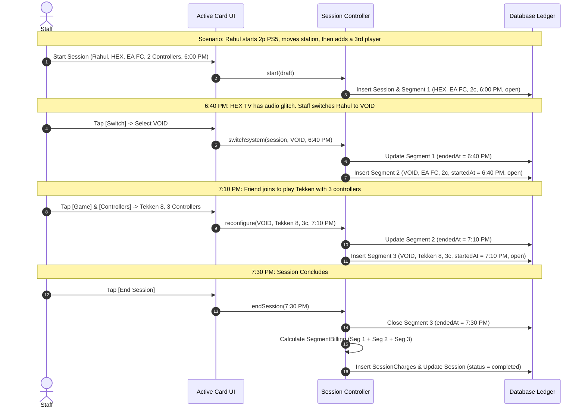
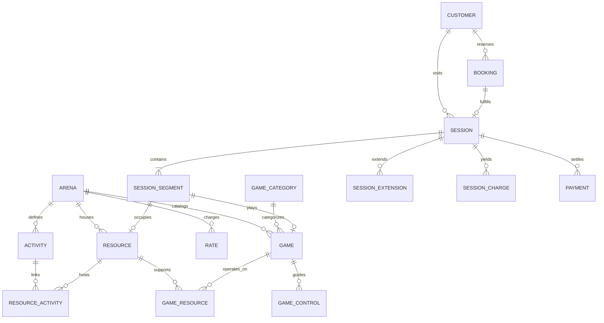

# Gaming Center Management System
## Master Product Requirements Document

---

### Document Information
- **Document Title:** Gaming Center Operations & Management System — Master Product Requirements Document
- **Document Version:** 1.0.0
- **Status:** Baseline Approved / Source of Truth
- **Date Created:** October 4, 2026
- **Target File Path:** `docs/GAMING_CENTER_PRODUCT_REQUIREMENTS.md`
- **Primary Audience:** Engineering, Product, Floor Staff, Operations Management, Gaming Center Owner

---

## 1. Document Purpose & Source of Truth Rules

### 1.1 Document Purpose
This document is the authoritative **Master Product Requirements Document (PRD)** and definitive **Source of Truth** for the Gaming Center Management System (codenamed `arena_ops`). It consolidates all operational workflows, functional specifications, domain models, business policies, pricing algorithms, hardware constraints, database schemas, validation rules, acceptance criteria, and open decisions into a single future-proof reference.

The primary objective is to eliminate ambiguity and prevent critical operational requirements from being forgotten or diluted during development. Every feature, edge case, and architectural constraint discussed across product planning sessions is preserved here.

### 1.2 Source of Truth Rules
To maintain the integrity of this specification throughout the software engineering lifecycle:
1. **No Code Without Specification:** No business logic, timing mechanism, pricing calculation, or database constraint may be written without direct grounding in this document.
2. **Strict Requirement Classification:** Every statement in this document is categorized explicitly:
   - **[CONFIRMED]**: Established operational reality or approved business rule. Must be implemented as specified.
   - **[PROPOSED IMPLEMENTATION]**: Recommended technical design or data model satisfying confirmed requirements.
   - **[OWNER CONFIRMATION REQUIRED]**: Operational policy knob where business stakeholder input is mandatory. Implemented via configurable parameters with explicit safe defaults (never hardcoded in UI or domain logic).
   - **[FUTURE/PHASE FEATURE]**: Requirements acknowledged for subsequent releases (P1, P2) that must not block MVP delivery but must not be architecturally precluded.
   - **[OPEN QUESTION]**: Unresolved architectural or product design question requiring further investigation.
3. **No Silent Assumptions:** If an edge case or business scenario is not explicitly defined, developers must not guess or invent rules. It must be logged in the *Owner Confirmation Required* or *Open Questions* registry.
4. **Historical Immutability:** Financial, timing, and session records must represent immutable event facts. Past sessions and charges must never be mutated retroactively when system configuration, catalog rates, or game data change.

---

## 2. Product Vision & Value Proposition

### 2.1 Plain-Language Summary
The system is a high-reliability, real-time **Gaming Center Operations Management System** built specifically for floor staff working in high-intensity gaming lounges. 

### 2.2 Core Mission Statement
> *"Help staff accurately manage gaming sessions, physical stations, game libraries, timing, pricing, and customer bookings with zero mental overhead and zero calculation errors while the gaming center is operating live."*

### 2.3 Key Operational Principles
- **Staff Operations First:** The system is an operational tool, not a marketing website. While public game guides and customer-facing booking portals exist, floor efficiency, fast station turnover, and precise billing for counter staff outrank every other priority.
- **Zero Mental Math:** Staff must never calculate elapsed time, remaining time, overtime, controller change surcharges, or split happy-hour rates in their heads. The system handles all arithmetic deterministically.
- **Resilient Timing:** Timers must never drift, reset, or freeze due to app restarts, browser tab suspensions, network outages, device reboots, or mid-session hardware switches.
- **Separation of Planned vs. Actual:** What a customer reserved (planned booking) and what they actually played (recorded session segments) are distinct historical records. Neither overwrites the other.
- **High-Velocity Mobile UX:** Staff carry mobile devices while walking the floor and stand behind counter tablets. Every primary floor action must be executable in under two taps with minimum 56px touch targets.

---

## 3. Users & Roles



### 3.1 Floor Staff (Primary Persona)
- **Role Context:** Works part-time on the floor, actively managing customers, handing out controllers, tracking game discs/installations, seating walk-ins, handling cash/UPI payments, and troubleshooting consoles.
- **Core Jobs-to-be-Done:**
  - Instantly see station occupancy, remaining time, and overtime across all stations.
  - Start a new walk-in or booked session in less than 10 seconds.
  - Dynamically move a customer from one station to another without resetting their clock or losing billed time.
  - Switch a customer’s game or add/remove controllers mid-session with immediate bill adjustment.
  - Check whether a requested game is installed and working on an available station.
  - Look up controller control mappings to explain basic game mechanics to beginner players.
  - Check out customers, accept multiple payment methods (Cash, UPI, Split), and record waivers.

### 3.2 Owner / Administrator
- **Role Context:** Gaming center owner responsible for profitability, hardware maintenance, staff oversight, and business reporting.
- **Core Jobs-to-be-Done:**
  - Track daily, weekly, and monthly billed, collected, and pending revenue.
  - Analyze station utilization rates, peak hours, and idle downtime.
  - Identify popular games, top-earning activities, and high-frequency customers.
  - Export clean financial ledgers to Microsoft Excel for accounting and tax reconciliation.
  - Configure rate cards, happy-hour windows, public holidays, and billing granularities without engineering assistance.

### 3.3 Customer / Public User
- **Role Context:** Casual or competitive gamer visiting the gaming center or checking offerings remotely from a smartphone.
- **Core Jobs-to-be-Done:**
  - Browse available games by category, platform, and multiplayer capability.
  - View game control schemes and basic move guides on their own mobile devices.
  - Check real-time or upcoming station availability.
  - Reserve a station or game in advance for a specific time window.

---

## 4. Current Operational Context & Equipment Inventory

### 4.1 Physical Stations & Activity Layout
The center operates a multi-activity entertainment floor:

| Resource Code | Resource Name | Kind | Supported Activities | Hardware / Constraints |
| :--- | :--- | :--- | :--- | :--- |
| `hex` | **HEX** | Station | `PS5` | Sony PlayStation 5 Console |
| `void` | **VOID** | Station | `PS5` | Sony PlayStation 5 Console |
| `ghost` | **GHOST** | Station | `PS5` | Sony PlayStation 5 Console |
| `rift` | **RIFT** | Station | `PS5`, `VR` | Hybrid Station: Sony PS5 + PlayStation VR2 (PSVR2) |
| `pool1` | **Pool Table 1** | Table | `POOL` | English / American Billiards Pool Table |
| `lounge1` | **Private Lounge** | Room | `LOUNGE` | Enclosed Private Room, sofa seating, large display |

### 4.2 The RIFT Concurrency Rule (Hard Constraint)
- Station **RIFT** physically houses both a PlayStation 5 console and a PlayStation VR2 headset setup.
- **Exclusion Rule:** RIFT can operate as a PS5 gaming station **OR** as a VR gaming station. **It can NEVER be used for PS5 and VR simultaneously.**
- **Enforcement:** The system model treats RIFT as a single physical resource entity. The database enforces that at most one open session segment can exist on resource `rift` at any given instant.

### 4.3 Center Operating Schedule
- **Weekly Schedule:**
  - **Monday – Sunday:** 14:00 – 23:00 IST (2:00 PM – 11:00 PM IST)
- **Happy Hours Window:**
  - **Days:** Monday, Tuesday, Wednesday, Thursday, Friday (Weekdays only)
  - **Hours:** 14:00 – 17:00 IST (2:00 PM – 5:00 PM IST)
  - **Exclusions:** Happy hours **NEVER** apply on Saturdays or Sundays. Happy hours **NEVER** apply on declared Public Holidays, even if falling on a Monday–Friday.

---

## 5. Core Staff Floor Problems (Pain Points & Requirements Mapping)

Staff members currently face 19 distinct operational bottlenecks during floor operations:

| # | Staff Pain Point | Operational Consequence | System Requirement / Solution |
| :--- | :--- | :--- | :--- |
| **1** | Does not know which systems are available right now. | Walk-in customers wait while staff physically checks screens. | Live station grid with clear available indicators. |
| **2** | Does not know which systems are occupied. | Risk of double-booking or seating walk-ins at reserved stations. | Prominent Occupied badges derived from active DB sessions. |
| **3** | Does not know which customer is at each system. | Staff forgets names, mixes up bills, and charges wrong groups. | Customer name and session card tied to each station. |
| **4** | Does not know which game is being played. | Staff cannot suggest alternatives or track game wear-and-tear. | Active game title prominently rendered on the station card. |
| **5** | Does not know controller count in use. | Controllers walk away or extra players play unpaid. | Controller badge (e.g., `2🎮`) visible on the active floor card. |
| **6** | Does not know when customer started. | Relying on memory leads to disputes with customers. | Immutable `startedAt` timestamp displayed in 12-hour IST format. |
| **7** | Does not know time remaining. | Staff cannot anticipate upcoming openings for waiting guests. | Tabular countdown timer (`MM:SS left`) updating live. |
| **8** | Does not know if customer is in overtime. | Customers play past paid duration for free without staff notice. | Card automatically turns amber (warning) then red (`Overtime MM:SS`). |
| **9** | Miscalculates complex billing totals. | Math mistakes on controller tiers and happy-hour splits. | Automated paise-exact billing engine with itemized receipt. |
| **10** | Customers switch stations mid-session. | Staff resets timer or starts a second bill, losing earlier time. | **System Switch:** Seamlessly closes segment, opens next; continuous session. |
| **11** | Customers change games mid-session. | Lost visibility into game popularity and compatibility. | **Game Change:** Seamless segment split preserving accurate playtime. |
| **12** | Customers change controller count mid-session. | Under-billing when 2 extra friends join for the second half. | **Controller Change:** Segment split recalculating price from that instant. |
| **13** | Does not know game installation locations. | Assigns customer to station where game is not downloaded. | Station [View Games] modal lists installed & playable games. |
| **14** | Does not know if game is currently working. | Discs scratched, corrupted patches, or controller sync issues. | Per-station game compatibility states (`playable`, `maintenance`, etc.). |
| **15** | Does not know if game is single or multiplayer. | Staff promises 4-player play for a 2-player or solo game. | Game library stores explicit `playerMode` and `maxLocalPlayers`. |
| **16** | Does not know max local players supported. | Groups of 4 attempt to play a 2-player fighter. | Display max local player count during station selection. |
| **17** | Cannot reliably book for future dates/times. | Notes on paper scraps get lost, causing double bookings. | Structured reservation system with conflict detection. |
| **18** | Cannot verify system compatibility during booking. | Bookings accepted for stations that cannot run the game. | **Game-First Booking Engine:** Filters only verified compatible stations. |
| **19** | Loses timing and pricing history during changes. | Customer disputes final charges; staff has no audit trail. | Immutable `SessionSegment` and `SessionCharge` ledger. |

---

## 6. Functional Requirements

### 6.1 Floor Overview & Station Monitoring (FR-FLOOR)
- **FR-FLOOR-01 [CONFIRMED]:** The system must provide a primary Staff Floor view displaying every physical resource in the center (`HEX`, `VOID`, `GHOST`, `RIFT`, `Pool Table 1`, `Private Lounge`).
- **FR-FLOOR-02 [CONFIRMED]:** Each station card must display:
  - Station name and activity type.
  - Operational status (`Available`, `Occupied`, `Maintenance`, `Disabled`).
  - Active customer name (if occupied).
  - Active game title (if applicable).
  - Active controller count (e.g., 1–4 controllers for PS5).
  - Session start time (`hh:mm a` IST) and scheduled end time.
  - Live elapsed time, remaining time, or overtime duration.
  - Running live bill amount in Indian Rupees (`₹XXX`).
- **FR-FLOOR-03 [CONFIRMED]:** Tapping an available station must immediately open the *New Session* modal pre-filled with that station.
- **FR-FLOOR-04 [CONFIRMED]:** Tapping an occupied station card must expose direct action triggers:
  - `[Controls]` (View game button guide)
  - `[Switch]` (Move session to another station)
  - `[Game]` (Switch active game title)
  - `[Controllers]` (Change active controller count)
  - `[Extend]` (Add 15, 30, or 60 minutes)
  - `[End]` (Conclude session and trigger checkout)
  - `[History]` (View chronological breakdown of all session segments)
- **FR-FLOOR-05 [CONFIRMED]:** Each station card must provide a `[View Games]` action that displays a searchable list of all games installed and playable on that specific console.
- **FR-FLOOR-06 [CONFIRMED]:** The floor screen must display an aggregated *Today Summary Strip* showing:
  - Billed revenue (`₹`)
  - Collected cash/UPI (`₹`)
  - Pending balance (`₹`)
  - Completed & active session count
  - Total customer gaming hours

### 6.2 New Session Creation (FR-START)
- **FR-START-01 [CONFIRMED]:** Staff can initiate a new session by selecting:
  - Customer (Search existing customer by name/phone or create inline with zero friction).
  - Activity (`PS5`, `VR`, `POOL`, `LOUNGE`).
  - Station (Filtered strictly to operational, available stations supporting the activity).
  - Game (Optional for Pool/Lounge; filtered to playable games on that station for PS5/VR).
  - Controller Count (Mandatory for PS5: 1, 2, 3, or 4 controllers).
  - Duration (Presets: 30m, 60m, 90m, 120m, or Open-Ended / Manual input).
- **FR-START-02 [CONFIRMED]:** The system must generate a live *Price Preview* before the session starts, detailing expected cost based on rate card, time band (standard vs. happy hour), and controller count.
- **FR-START-03 [CONFIRMED]:** The system must reject session creation if the requested station has an active session or an overlapping future booking within the requested duration.
- **FR-START-04 [CONFIRMED]:** Starting a session atomically snapshots the center's active rate card and billing policy into the session record, guaranteeing that future rate card changes will never alter past bills.

### 6.3 Dynamic In-Session Transitions (FR-TRANS)
- **FR-TRANS-01 (Station Switch) [CONFIRMED]:**
  - Staff can move an active session to a different station.
  - The destination station must be operational, currently unoccupied, and compatible with the activity and game.
  - At the exact transition timestamp $T_{\text{switch}}$, the current `SessionSegment` is closed (`endedAt = T_switch`), and a new `SessionSegment` is created (`startedAt = T_switch`).
  - The overall session timer and parent `Session` remain continuous. Zero time is lost, and zero time overlaps.
- **FR-TRANS-02 (Game Switch) [CONFIRMED]:**
  - Staff can change the active game during a session.
  - Only games marked `playable` on the current console may be selected.
  - Closes the active segment and opens a new segment with the new `gameId` at the exact switch timestamp.
- **FR-TRANS-03 (Controller Count Switch) [CONFIRMED]:**
  - Staff can adjust the controller count (e.g., 2 players $\rightarrow$ 4 players).
  - Closes the active segment and opens a new segment with the updated `controllerCount` at that instant.
  - Subsequent billing math automatically applies the updated controller tier rate starting from the switch timestamp.



### 6.4 Session Extension & Time Management (FR-EXT)
- **FR-EXT-01 [CONFIRMED]:** Staff can extend an active session by selecting $+15$, $+30$, or $+60$ minutes.
- **FR-EXT-02 [CONFIRMED]:** The system must compute the **Maximum Extension Limit** based on:
  1. Upcoming reservations on that station (session may touch but cannot overlap booking start time).
  2. Operating closing time (23:00 IST), unless overridden by policy.
- **FR-EXT-03 [CONFIRMED]:** Extensions are recorded in an append-only `SessionExtension` table, preserving the previous scheduled end, new scheduled end, and incremental cost.

### 6.5 Session Completion & Payment Settlement (FR-PAY)
- **FR-PAY-01 [CONFIRMED]:** Concluding a session executes the *Segment Billing Engine*, freezing actual end time (`actualEndedAt = now`) and writing permanent `SessionCharge` line items.
- **FR-PAY-02 [CONFIRMED]:** Staff is presented with an itemized checkout sheet displaying:
  - Chronological breakdown of each segment (Station, Game, Controllers, Duration, Subtotal).
  - Band rate details (standard vs. happy hour).
  - Total amount due in whole Rupees.
- **FR-PAY-03 [CONFIRMED]:** The system supports multiple payment methods:
  - `Cash`
  - `UPI` (Google Pay, PhonePe, Paytm, BHIM)
  - `Card` (Credit / Debit)
  - `Other`
- **FR-PAY-04 [CONFIRMED]:** Supports partial payments, split tenders (e.g., ₹200 UPI + ₹100 Cash), zero-balance full settlements, and authorized fee waivers (`markWaived = true`).
- **FR-PAY-05 [CONFIRMED]:** Payments are strictly append-only. Refunds or corrections are recorded as negative payment entries with a mandatory reason note.

### 6.6 Booking & Reservation Engine (FR-BOOK)
- **FR-BOOK-01 [CONFIRMED]:** Staff can create future bookings specifying:
  - Customer name & phone number.
  - Date & start time (within operating hours).
  - Requested duration.
  - Activity type (`PS5`, `VR`, `POOL`, `LOUNGE`).
  - Requested game title.
  - Required player count and controller count.
  - Station preference: **Specific System** (e.g., `VOID`) OR **Any Compatible System**.
- **FR-BOOK-02 [CONFIRMED]:** The booking system checks availability across the entire requested time window against active sessions, overlapping bookings, maintenance blocks, and the RIFT PS5/VR mutual exclusion.
- **FR-BOOK-03 [CONFIRMED]:** Check-in flow: When a customer arrives for their booking, staff taps `[Check In]`. This seamlessly generates an active `Session` linked to the `bookingId`. The booking record remains intact as the historical "Planned" baseline.

### 6.7 Game Library & Hardware Compatibility (FR-LIB)
- **FR-LIB-01 [CONFIRMED]:** Catalog records for every game must maintain:
  - Official Title & common aliases (e.g., "EA SPORTS FC 25", aliases: ["EA FC", "FIFA"]).
  - Category (Football, Fighting, Wrestling, Racing, Action, Shooter, Sports, VR, Other).
  - Supported Platforms (`PS5`, `PSVR2`).
  - Player Mode (`single`, `local`, `online`, `both`).
  - Maximum local player capacity (1, 2, 4).
  - Active status (Disabled games are hidden from pickers but preserved for historical session lookups).
- **FR-LIB-02 [CONFIRMED]:** Compatibility Matrix (`GameResource`):
  - Every game has an explicit installation/working status on each console:
    - `playable`: Installed, updated, working perfectly.
    - `not_playable`: Installed but malfunctioning (e.g., corrupted patch, hardware issue).
    - `not_installed`: Game is not downloaded on this machine.
    - `maintenance`: System or game undergoing updates.
    - `temporarily_unavailable`: Game disc in use elsewhere or temporary license issue.
- **FR-LIB-03 [CONFIRMED]:** Staff can view and edit compatibility flags directly from the station game view or library management screens.

### 6.8 Game Controls Guide (FR-CTRL)
- **FR-CTRL-01 [CONFIRMED]:** Game control configurations are stored with structured tokens representing hardware buttons:
  - Tokens: `CROSS`, `CIRCLE`, `SQUARE`, `TRIANGLE`, `L1`, `R1`, `L2`, `R2`, `L3`, `R3`, `DPAD_UP`, `DPAD_DOWN`, `DPAD_LEFT`, `DPAD_RIGHT`, `OPTIONS`, `TOUCHPAD`.
- **FR-CTRL-02 [CONFIRMED]:** The UI renders these tokens as authentic PlayStation controller glyphs.
- **FR-CTRL-03 [CONFIRMED]:** Controls are organized into logical sections (e.g., Attacking, Defending, Goalkeeping, Basic Moves, Combos).
- **FR-CTRL-04 [CONFIRMED]:** Staff or public users can summon the control sheet instantly from an active session or the public catalog without interrupting operations.

### 6.9 Customer Profiles & Visit History (FR-CUST)
- **FR-CUST-01 [CONFIRMED]:** Lightweight customer directory capturing Name, Phone, and Notes (e.g., "Prefers VOID station", "Regular FIFA tournament player").
- **FR-CUST-02 [CONFIRMED]:** Derived customer statistics computed on-the-fly from session facts:
  - Total visit days & total sessions played.
  - Cumulative gaming hours.
  - Cumulative money spent.
  - Average spend per visit.
  - Favorite activity & most played game.
  - Date and time of last visit.

### 6.10 Reporting & Business Intelligence (FR-REP)
- **FR-REP-01 [CONFIRMED]:** Daily Executive Summary:
  - $\text{Billed} = \sum(\text{final session charges})$.
  - $\text{Collected} = \sum(\text{payments received})$.
  - $\text{Pending} = \text{Billed} - \text{Collected} - \text{Waived}$.
  - Peak occupancy hour identification.
- **FR-REP-02 [CONFIRMED]:** Multi-Date Aggregations: Filterable by Today, This Week, This Month, or Custom Date Range.
- **FR-REP-03 [CONFIRMED]:** Activity Breakdown: Revenue and total hours segmented by `PS5`, `VR`, `POOL`, and `LOUNGE`.
- **FR-REP-04 [CONFIRMED]:** Station Utilization: Hours occupied vs. hours idle per station.

### 6.11 Spreadsheet Export (FR-XLS)
- **FR-XLS-01 [CONFIRMED]:** The system must generate a multi-tab Microsoft Excel (`.xlsx`) workbook containing:
  1. `Summary`: Macro financial KPIs, total hours, customer count.
  2. `Sessions`: Chronological list of every session with start, end, duration, customer, station list, final bill, status.
  3. `Segments`: Micro-level segment audit trail (exact time intervals, station, game, controllers).
  4. `Payments`: Complete transaction log (Method, Amount, Session ID, Refund flag, Timestamp).
  5. `Customers`: Customer directory with aggregate visits, hours, and spend.
  6. `Games`: Play counts and total hours logged per game title.
  7. `Stations`: Utilization percentage and uptime hours per physical station.
  8. `Revenue by Activity`: Comparative revenue matrices.
  9. `Revenue by Date`: Day-by-day revenue trends.

---

## 7. Business Rules & Operational Policies

### 7.1 Pricing Rate Card (Confirmed Base Rates)

All currency calculations are processed internally as integer **paise** (1 Rupee = 100 paise) to eliminate floating-point rounding errors.

```
┌────────────────────────────────────────────────────────────────────────┐
│                        RATE CARD SPECIFICATION                         │
├───────────────────┬──────────────┬──────────────────┬──────────────────┤
│ Activity          │ Pricing Unit │ Standard Rate    │ Happy Hour Rate  │
├───────────────────┼──────────────┼──────────────────┼──────────────────┤
│ PS5 (1 Controller)│ 60 minutes   │ ₹150 (15,000 p)  │ ₹120 (12,000 p)  │
│ PS5 (2 Controller)│ 60 minutes   │ ₹280 (28,000 p)  │ ₹220 (22,000 p)  │
│ PS5 (3 Controller)│ 60 minutes   │ ₹390 (39,000 p)  │ ₹310 (31,000 p)  │
│ PS5 (4 Controller)│ 60 minutes   │ ₹480 (48,000 p)  │ ₹380 (38,000 p)  │
│ VR (PSVR2)        │ 30 minutes   │ ₹200 (20,000 p)  │ No Happy Rate    │
│ Pool Table 1      │ 60 minutes   │ ₹275 (27,500 p)  │ ₹220 (22,000 p)  │
│ Private Lounge    │ 60 minutes   │ ₹2,000(200,000 p)│ No Happy Rate    │
└───────────────────┴──────────────┴──────────────────┴──────────────────┘
```

### 7.2 Happy-Hour Boundary Splitting Rule (BR-PRC-01)
- When an active session segment crosses the happy-hour threshold (e.g., starts at 16:30 IST during Happy Hour and ends at 17:30 IST in Standard Band):
  - The interval is strictly sliced into sub-intervals at the 17:00 IST boundary.
  - The portion falling within 16:30–17:00 is charged at the applicable Happy Hour rate.
  - The portion falling within 17:00–17:30 is charged at the applicable Standard rate.
  - **Example (PS5 1 Controller, 16:30–17:30):**
    - $30 \text{ min Happy} = \frac{30}{60} \times ₹120 = ₹60.00$
    - $30 \text{ min Standard} = \frac{30}{60} \times ₹150 = ₹75.00$
    - $\text{Total Bill} = ₹60 + ₹75 = ₹135.00$ (13,500 paise).

### 7.3 Holiday Exclusion Rule (BR-PRC-02)
- If the current date is registered in the public holidays directory (`holidays` table):
  - Happy hour rates are completely disabled.
  - All hours played on that day are priced exclusively under the Standard Rate Band.

### 7.4 Overtime Policy (BR-TIME-01)
- Overtime is **not** a separate database status; it is a live calculated condition where $\text{current\_time} > \text{scheduledEndAt}$.
- Overtime is billed continuously at the prevailing band rate until staff formally concludes the session.
- A session card displays overtime in high-contrast red warning styling to compel staff action.

### 7.5 Station Exclusivity & Concurrency (BR-RES-01)
- A physical station cannot host more than one open session segment at any time.
- RIFT is a single resource; an active PS5 session on RIFT blocks VR sessions, and an active VR session blocks PS5 sessions.

---

## 8. Data Architecture & Entity Relationship Model

### 8.1 Entity Relationship Diagram (ERD)



### 8.2 Relational Database Schema Specifications

#### 8.2.1 `customers`
```sql
CREATE TABLE customers (
    id TEXT PRIMARY KEY,
    name TEXT NOT NULL,
    phone TEXT,
    notes TEXT,
    last_visit_at TIMESTAMPTZ,
    created_at TIMESTAMPTZ NOT NULL,
    updated_at TIMESTAMPTZ NOT NULL
);
CREATE INDEX idx_customers_phone ON customers(phone);
CREATE INDEX idx_customers_name ON customers(name);
```

#### 8.2.2 `activities`
```sql
CREATE TABLE activities (
    id TEXT PRIMARY KEY,
    code TEXT NOT NULL UNIQUE, -- 'PS5', 'VR', 'POOL', 'LOUNGE'
    name TEXT NOT NULL,
    uses_controllers BOOLEAN NOT NULL DEFAULT FALSE,
    uses_games BOOLEAN NOT NULL DEFAULT FALSE,
    duration_model TEXT NOT NULL, -- 'hourly', 'unit', 'flat_hourly'
    happy_hour_eligible BOOLEAN NOT NULL DEFAULT FALSE,
    sort_order INTEGER NOT NULL DEFAULT 0,
    active BOOLEAN NOT NULL DEFAULT TRUE
);
```

#### 8.2.3 `resources`
```sql
CREATE TABLE resources (
    id TEXT PRIMARY KEY,
    name TEXT NOT NULL UNIQUE, -- 'HEX', 'VOID', 'GHOST', 'RIFT', 'Pool Table 1', 'Private Lounge'
    kind TEXT NOT NULL, -- 'station', 'table', 'room'
    status TEXT NOT NULL DEFAULT 'available', -- 'available', 'maintenance', 'disabled'
    sort_order INTEGER NOT NULL DEFAULT 0
);
```

#### 8.2.4 `resource_activities`
```sql
CREATE TABLE resource_activities (
    resource_id TEXT NOT NULL REFERENCES resources(id) ON DELETE CASCADE,
    activity_code TEXT NOT NULL REFERENCES activities(code) ON DELETE CASCADE,
    PRIMARY KEY (resource_id, activity_code)
);
```

#### 8.2.5 `games` & `game_resources`
```sql
CREATE TABLE games (
    id TEXT PRIMARY KEY,
    name TEXT NOT NULL,
    aliases TEXT NOT NULL DEFAULT '[]', -- JSON array of strings
    category_id TEXT REFERENCES game_categories(id),
    platforms TEXT NOT NULL DEFAULT '[]', -- JSON array: ['PS5', 'PSVR2']
    player_mode TEXT NOT NULL DEFAULT 'single', -- 'single', 'local', 'online', 'both'
    max_local_players INTEGER NOT NULL DEFAULT 1,
    active BOOLEAN NOT NULL DEFAULT TRUE,
    last_played_at TIMESTAMPTZ
);

CREATE TABLE game_resources (
    game_id TEXT NOT NULL REFERENCES games(id) ON DELETE CASCADE,
    resource_id TEXT NOT NULL REFERENCES resources(id) ON DELETE CASCADE,
    status TEXT NOT NULL, -- 'playable', 'not_playable', 'not_installed', 'maintenance', 'temporarily_unavailable'
    PRIMARY KEY (game_id, resource_id)
);
```

#### 8.2.6 `sessions` (Parent Continuous Visit)
```sql
CREATE TABLE sessions (
    id TEXT PRIMARY KEY,
    booking_id TEXT REFERENCES bookings(id),
    customer_id TEXT NOT NULL REFERENCES customers(id),
    status TEXT NOT NULL, -- 'active', 'completed', 'voided'
    payment_status TEXT NOT NULL, -- 'unpaid', 'partial', 'paid', 'waived'
    started_at TIMESTAMPTZ NOT NULL,
    scheduled_end_at TIMESTAMPTZ NOT NULL,
    actual_ended_at TIMESTAMPTZ,
    pricing_snapshot TEXT NOT NULL, -- Complete serialized snapshot of rates + policy
    billed_amount_paise INTEGER,
    void_reason TEXT,
    created_at TIMESTAMPTZ NOT NULL,
    updated_at TIMESTAMPTZ NOT NULL
);
CREATE INDEX idx_sessions_active ON sessions(status) WHERE status = 'active';
CREATE INDEX idx_sessions_customer ON sessions(customer_id);
```

#### 8.2.7 `session_segments` (Critical Architecture Component)
```sql
CREATE TABLE session_segments (
    id TEXT PRIMARY KEY,
    session_id TEXT NOT NULL REFERENCES sessions(id) ON DELETE CASCADE,
    segment_index INTEGER NOT NULL,
    resource_id TEXT NOT NULL REFERENCES resources(id),
    activity_code TEXT NOT NULL,
    game_id TEXT REFERENCES games(id),
    controller_count INTEGER,
    started_at TIMESTAMPTZ NOT NULL,
    ended_at TIMESTAMPTZ, -- NULL indicates the active, open segment
    created_at TIMESTAMPTZ NOT NULL
);

-- Crucial integrity constraint: exactly ONE open segment per resource center-wide!
CREATE UNIQUE INDEX ux_one_open_segment_per_resource 
ON session_segments (resource_id) 
WHERE ended_at IS NULL;

CREATE INDEX idx_session_segments_lookup ON session_segments(session_id, segment_index);
```

#### 8.2.8 `session_charges` (Immutable Accounting Line Items)
```sql
CREATE TABLE session_charges (
    id TEXT PRIMARY KEY,
    session_id TEXT NOT NULL REFERENCES sessions(id) ON DELETE CASCADE,
    segment_id TEXT REFERENCES session_segments(id),
    segment_index INTEGER NOT NULL,
    band_code TEXT NOT NULL, -- 'standard', 'happy'
    activity_code TEXT NOT NULL,
    resource_id TEXT,
    controller_count INTEGER,
    segment_start TIMESTAMPTZ NOT NULL,
    segment_end TIMESTAMPTZ NOT NULL,
    played_minutes INTEGER NOT NULL,
    billed_minutes INTEGER NOT NULL,
    unit_minutes INTEGER NOT NULL,
    unit_price_paise INTEGER NOT NULL,
    amount_paise INTEGER NOT NULL
);
```

#### 8.2.9 `payments` (Append-Only Transaction Ledger)
```sql
CREATE TABLE payments (
    id TEXT PRIMARY KEY,
    session_id TEXT NOT NULL REFERENCES sessions(id) ON DELETE CASCADE,
    amount_paise INTEGER NOT NULL, -- Negative indicates refund
    method TEXT NOT NULL, -- 'cash', 'upi', 'card', 'other'
    is_refund BOOLEAN NOT NULL DEFAULT FALSE,
    note TEXT,
    reason TEXT,
    created_at TIMESTAMPTZ NOT NULL
);
CREATE INDEX idx_payments_session ON payments(session_id);
```

#### 8.2.10 `bookings` (Future Planned Reservations)
```sql
CREATE TABLE bookings (
    id TEXT PRIMARY KEY,
    customer_id TEXT REFERENCES customers(id),
    activity_code TEXT NOT NULL,
    game_id TEXT REFERENCES games(id),
    resource_id TEXT REFERENCES resources(id), -- NULL = 'Any Compatible System'
    scheduled_start TIMESTAMPTZ NOT NULL,
    scheduled_end TIMESTAMPTZ NOT NULL,
    players_required INTEGER,
    controller_requirement INTEGER,
    status TEXT NOT NULL, -- 'booked', 'checked_in', 'cancelled', 'no_show'
    created_at TIMESTAMPTZ NOT NULL,
    updated_at TIMESTAMPTZ NOT NULL
);
CREATE INDEX idx_bookings_range ON bookings(scheduled_start, scheduled_end);
```

---

## 9. Timing & Clock Architecture

### 9.1 Absolute Timestamp Invariant
- **Rule:** The system **never** relies on browser counters, JavaScript `setInterval` ticks, or in-memory stopwatches as the source of truth for duration.
- **Implementation:** All timing values are purely derived from absolute UTC timestamps:
  - $\text{Elapsed}(t) = (\text{actualEndedAt} \mathbin{?} \text{actualEndedAt} : t) - \text{startedAt}$
  - $\text{Remaining}(t) = \max(0, \text{scheduledEndAt} - (\text{actualEndedAt} \mathbin{?} \text{actualEndedAt} : t))$
  - $\text{Overtime}(t) = \max(0, t - \text{scheduledEndAt}) \quad (\text{if active})$
- **State Recovery:** If a staff tablet runs out of battery, reboots, refreshes the browser, or loses network for 45 minutes, restarting the application instantly calculates the exact elapsed time, remaining time, and running bill with zero error.

### 9.2 Visual Urgency Thresholds
To provide effortless peripheral awareness for floor staff:
1. **Normal State (Green):** $\text{Remaining} > 5 \text{ minutes}$. Card displays subtle green container tint.
2. **Warning State (Amber):** $\text{Remaining} \le 5 \text{ minutes}$ and $\text{Remaining} > 0$. Card turns amber with prominent timer indicator, alerting staff to approach the station and ask if the customer wishes to extend.
3. **Overtime State (Red):** $t > \text{scheduledEndAt}$. Card turns red with an alert icon and active elapsed overtime timer (`Overtime 08:24`), alerting staff to either bill the extra time or clear the station for the next booking.

---

## 10. Billing Engine & Mathematical Formulation

### 10.1 Multi-Segment Pricing Formulation
For a session $S$ composed of $n$ chronological segments $\{s_1, s_2, \dots, s_n\}$:

$$\text{Subtotal}(S) = \sum_{i=1}^{n} \text{SegmentCost}(s_i)$$

Each segment $s_i$ spanning $[T_{\text{start}, i}, T_{\text{end}, i}]$ is evaluated against happy-hour boundaries, producing sub-intervals $k$ with rate band $B_k \in \{\text{Standard}, \text{Happy}\}$:

$$\text{SegmentCost}(s_i) = \sum_{k} \text{CalculateSubInterval}(s_{i,k}, B_k, \text{RateCard}_{\text{snapshot}})$$

$$\text{FinalAmount}(S) = \text{ApplyMoneyRounding}(\text{Subtotal}(S), \text{RoundingPolicy})$$

### 10.2 Paise Arithmetic & Precision Rules
1. **No Floats:** Rate prices, subtotals, charges, and payment amounts must be stored and computed as 64-bit signed integers representing paise.
2. **Half-Up Divisor Arithmetic:** Where division is required (e.g., prorating hourly rates over minutes or seconds), the calculation uses integer arithmetic with half-up rounding:
   $$\text{roundDivHalfUp}(N, D) = \left\lfloor \frac{N + \lfloor D / 2 \rfloor}{D} \right\rfloor$$
3. **Session-Level Cash Rounding:** Rounding to physical currency units (default: nearest ₹1 / 100 paise) is applied **once** to the session total, never cumulatively across individual segments, preventing fractional loss during frequent mid-session switches.

---

## 11. Game-First Booking Availability Algorithm

When a customer requests a booking for Game $G$ at time interval $W = [T_{\text{start}}, T_{\text{end}}]$ requiring $P$ players:

```
Algorithm: ResolveGameFirstBooking(G, W, P, ActivityCode)
Input: Game G, Window W, Required Players P, Activity ActivityCode
Output: List of Available Resources

1. If P > G.maxLocalPlayers:
       Return EMPTY_LIST ("Game supports up to G.maxLocalPlayers players")

2. EligibleResources = []
3. For each Resource R in SystemResources:
       a. If R.status != 'available': Continue
       b. If ActivityCode not in R.activityCodes: Continue
       c. If Compatibility[G.id, R.id].status != 'playable': Continue
       d. HasConflict = False
       e. For each Occupancy O in ActiveSessions union ExistingBookings:
              If O.resourceId == R.id and O.interval overlaps W:
                     HasConflict = True
                     Break
       f. If Not HasConflict:
              Append R to EligibleResources

4. Return EligibleResources
```

If `EligibleResources` is empty, the UI displays:
> *"No compatible system is available for [Game Name] during the requested time window."*

---

## 12. User Interface & Responsive Design Requirements

### 12.1 Hardware Form Factors
- **Primary Form Factor (Floor Mobile):** Android / iOS smartphone carried by walking floor staff (360px – 430px viewport width). Single-thumb ergonomics, bottom navigation, bottom-sheet action drawers.
- **Secondary Form Factor (Counter Tablet):** 10-inch to 12-inch counter tablet (iPad / Android Tablet in landscape or portrait, 768px – 1024px width). 2-column or 3-column station grid.
- **Tertiary Form Factor (Desktop / Laptop):** Back-office desktop browser for owner reporting and Excel export (1280px+ width).

### 12.2 Critical UI Standards
1. **Minimum Touch Target:** All primary interactive controls, buttons, and tiles must have a minimum touch target height of **56px** (`AppSpacing.minTarget`).
2. **Tabular Monospaced Digits:** All timer strings (`MM:SS`), clock displays (`hh:mm a`), and currency amounts (`₹XXX`) must enforce monospaced tabular figure font rendering (`FontFeature.tabularFigures()`) to prevent jittering during live re-renders.
3. **High-Contrast Peripheral Legibility:** Staff standing 2 meters away from a counter tablet must be able to tell station status and overtime at a glance via distinct container colors (Green, Amber, Red).

---

## 13. Security, Authentication & Role Separation

### 13.1 Conceptual Perimeter Separation
The system maintains a strict architectural separation between public information access and protected operations:

```
┌────────────────────────────────────────────────────────┐
│                   PUBLIC ACCESS ZONE                   │
│  (No authentication required · Read-only access)       │
│  • Public Game Library catalog                         │
│  • Game Categories & Multi-player information          │
│  • PlayStation Control Guides & Glyphs                 │
│  • Basic Activity & Pricing Cards                      │
└───────────────────────────┬────────────────────────────┘
                            │
              [ Authenticated Staff Gate ]
                            │
┌───────────────────────────▼────────────────────────────┐
│               PROTECTED FLOOR OPERATIONS               │
│  (PIN / Password authenticated · Active counter staff) │
│  • Live Station Grid & Real-time Timers                │
│  • Start, Switch, Extend, End Sessions                 │
│  • Checkout & Payment Collection                       │
│  • Customer Creation & Direct Reservations             │
└───────────────────────────┬────────────────────────────┘
                            │
              [ Administrative Owner Gate ]
                            │
┌───────────────────────────▼────────────────────────────┐
│              ADMIN / OWNER MANAGEMENT ZONE             │
│  (Privileged Role · Owner credentials)                 │
│  • Financial Summary & Revenue Reports                 │
│  • Excel Data Workbook Export                          │
│  • Rate Card & Happy Hour Policy Configuration         │
│  • Staff Account Management & Audit Logs               │
└────────────────────────────────────────────────────────┘
```

---

## 14. Phased Implementation Roadmap (MVP vs. Future)

### 14.1 Phase 0: P0 Requirements (MVP — MUST WORK FIRST)
The following 18 functional items constitute the absolute non-negotiable floor core:
1. **Staff Floor Screen:** Real-time visual station overview.
2. **Resource Availability:** Operational status tracking (`available`, `occupied`, `maintenance`, `disabled`).
3. **Game ↔ Resource Compatibility:** Hardware matrix enforcing where games can and cannot run.
4. **Game Working Status:** Per-station installation state (`playable`, `not_installed`, etc.).
5. **Player Mode Visibility:** Explicit single/local-multiplayer and max player counts.
6. **New Session Creation:** Fast customer assignment, duration selection, price preview.
7. **Timestamp-Accurate Timers:** Absolute UTC-based elapsed, remaining, and overtime calculation.
8. **Controller Tracking:** Accurate 1, 2, 3, and 4-controller tracking for PS5.
9. **Game Switching:** Mid-session game change generating contiguous segments.
10. **System Switching:** Mid-session console change with zero time loss or overlap.
11. **Session Segments Architecture:** Parent session preserving ordered historical segments.
12. **Session Extension:** Conflict-aware $+15$, $+30$, $+60$ min extensions capped by bookings.
13. **Deterministic Pricing Engine:** Segment-based billing with automatic happy-hour splitting in paise.
14. **End Session Workflow:** Complete segment ledger freeze and bill summary generation.
15. **Payment Settlement:** Append-only payments (Cash, UPI, Card, Waived) and partial tracking.
16. **Booking Management:** Advance reservations with planned start/end times.
17. **Game Availability in Booking:** Game-first compatibility check over full duration.
18. **RIFT Concurrency Enforcement:** Strict mutual exclusion between PS5 and VR on RIFT.

### 14.2 Phase 1: P1 Requirements (Operational Expansion)
- Customer visit history and derived profile statistics.
- Interactive PlayStation game control guides with glyph token rendering.
- Daily financial reporting strip (Billed, Collected, Pending, Active).
- Complete multi-tab Microsoft Excel (`.xlsx`) export.

### 14.3 Phase 2: P2 Requirements (Advanced & Public Capabilities)
- Public guest booking interface with self-service reservation requests.
- Customer loyalty points, membership packages, and prepaid gaming credit wallets.
- WhatsApp / SMS automated booking confirmation and digital receipt delivery.
- Cloud-synced multi-device concurrent operations backed by remote Supabase Postgres.

---

## 15. Testing Requirements & Verification Matrix

The application must pass comprehensive verification across six testing categories before production deployment:

### 15.1 Timer & Clock Integrity
- **Test T-01 (Normal Timer Progression):** Verify timer reflects elapsed and remaining minutes matching a simulated monotonic clock.
- **Test T-02 (Reboot Resilience):** Simulate app restart 45 minutes into a 60-minute session; verify timer instantly displays 45m elapsed, 15m remaining.
- **Test T-03 (Warning Trigger):** Verify card transitions to amber container at exactly 5 minutes remaining.
- **Test T-04 (Overtime Trigger):** Verify card transitions to red container and begins count-up timer the instant scheduled end time is passed.
- **Test T-05 (Extension Application):** Extending an overtime session by 30 minutes pushes scheduled end time forward and reverts card state to normal/warning immediately.

### 15.2 System & Game Switching
- **Test S-01 (HEX to VOID Switch):** Customer switches from HEX to VOID at minute 40 of a 60m session. Verify Segment 1 ends at 40m, Segment 2 starts at 40m, parent session remains active, and total duration is 60m.
- **Test S-02 (Occupied Target Rejection):** Attempting to switch to an occupied station fails with error `resource_busy`.
- **Test S-03 (Incompatible Target Rejection):** Attempting to switch to a station where the active game is `not_playable` fails with error `game_incompatible`.

### 15.3 Controller Scaling & Segment Billing
- **Test C-01 (1 to 2 Controller Transition):** 30m with 1 controller + 30m with 2 controllers (Standard PS5).
  - Segment 1: $30 \text{ min} \times ₹150/\text{hr} = ₹75.00$
  - Segment 2: $30 \text{ min} \times ₹280/\text{hr} = ₹140.00$
  - Expected Bill: $₹215.00$ (21,500 paise). Verified via automated test.
- **Test C-02 (2 to 1 Controller Transition):** Price drops accordingly for the second segment; previous segment bill remains frozen.

### 15.4 Booking Availability & Collision Detection
- **Test B-01 (Full Period Free):** Booking accepted when compatible station has no overlapping sessions or bookings.
- **Test B-02 (Partial Overlap Rejection):** Booking rejected if an active session or future reservation overlaps by even 1 minute.
- **Test B-03 (Touching Boundary Permitted):** Booking starting at 18:00 is allowed on a station whose preceding booking ends at 18:00 (half-open interval $[17:00, 18:00)$ and $[18:00, 19:00)$).
- **Test B-04 (RIFT PS5 ⊕ VR Conflict):** An existing VR booking on RIFT strictly blocks a PS5 booking on RIFT for the same window.

### 15.5 Happy-Hour Pricing Boundary
- **Test H-01 (Boundary Split):** Friday 16:30–17:30 PS5 1 Controller splits into 30m Happy (₹60) + 30m Standard (₹75) = ₹135.
- **Test H-02 (Weekend Exclusion):** Saturday 16:30–17:30 PS5 1 Controller charges full Standard (₹150).
- **Test H-03 (Holiday Exclusion):** Public holiday on Friday charges full Standard (₹150).

---

## 16. Owner Confirmation Required (Business Decision Registry)

The following operational knobs represent business rules where final confirmation from the gaming center owner is required. The system implements safe, documented default assumptions that allow immediate testing and deployment while enabling instantaneous updates once confirmed:

| # | Question / Operational Policy | Current Understanding & Technical Default | Alternatives Considered | Confirmation Status | Implementation Location |
| :--- | :--- | :--- | :--- | :--- | :--- |
| **1** | **Partial-Time Billing Granularity** | Default: `perMinute` proration (true actual time played). | 15-min / 30-min / 60-min fixed blocks. | 🟡 PENDING OWNER | `BillingPolicy.billingUnit` |
| **2** | **Block Rounding Direction** | Default: `roundUp` to next unit when using blocks. | `nearest` unit. | 🟡 PENDING OWNER | `BillingPolicy.blockRounding` |
| **3** | **Grace Period** | Default: `0 minutes` (all played time is billed). | 5 min or 10 min free if cancelled immediately. | 🟡 PENDING OWNER | `BillingPolicy.graceMinutes` |
| **4** | **Minimum Session Charge** | Default: `0 minutes` (no minimum base charge). | 30 min or 60 min mandatory minimum. | 🟡 PENDING OWNER | `BillingPolicy.minimumChargeMinutes` |
| **5** | **Early Exit Billing Basis** | Default: `actualTime` (customer pays for time played). | `plannedDuration` (pay for reserved time). | 🟡 PENDING OWNER | `BillingPolicy.earlyExit` |
| **6** | **Rounding Scope** | Default: `wholeSession` (sum paise, round once at checkout). | `perSegment` (round each segment independently). | 🟡 PENDING OWNER | `BillingPolicy.roundingScope` |
| **7** | **Late Arrival for Bookings** | Default: `actualStart` (timer starts when customer arrives). | `plannedBooking` (bill from scheduled start). | 🟡 PENDING OWNER | `BillingPolicy.lateArrival` |
| **8** | **VR Happy-Hour Eligibility** | Default: `false` (VR flat ₹200/30m; no happy rate given). | `true` (Owner provides discount VR rate). | 🟡 PENDING OWNER | `Activity.happyHourEligible` |
| **9** | **Private Lounge Happy-Hour Eligibility**| Default: `false` (Lounge flat ₹2,000/hr). | `true` (Owner provides discount lounge rate). | 🟡 PENDING OWNER | `Activity.happyHourEligible` |
| **10**| **VR Partial Unit Billing** | Default: `roundUpUnit` (31 min $\rightarrow$ 2 units = ₹400). | `prorate` per-minute / `nearest` block. | 🟡 PENDING OWNER | `BillingPolicy.vrUnitRounding` |
| **11**| **Lounge Minimum Duration & Inclusions** | Default: `60 minutes`, no bundled snacks/consoles. | Custom bundle packages. | 🟡 PENDING OWNER | `Activity`/`BillingPolicy` |
| **12**| **Cash Money Rounding Granularity** | Default: Nearest `₹1` (100 paise). | Nearest ₹5 or ₹10. | 🟡 PENDING OWNER | `BillingPolicy.moneyRounding` |
| **13**| **Payment Timing Policy** | Default: `either` (Pay at start or pay at checkout). | Mandatory prepay / Mandatory postpay. | 🟡 PENDING OWNER | `BillingPolicy.paymentTiming` |
| **14**| **Extensions Past 23:00 Closing** | Default: `blocked` (Strict stop at 11:00 PM). | Allowed with staff override. | 🟡 PENDING OWNER | `BillingPolicy.allowExtendPastClose` |
| **15**| **Mid-Session Pause Support** | Default: `not supported` in MVP (time runs continuously).| Supported (clock freeze for meals/breaks). | 🟡 PENDING OWNER | `SessionService` seam |
| **16**| **Discount Rules & Complimentary Approval**| Default: Manual comp via `waived` status. | Percentage discount codes & manager PIN. | 🟡 PENDING OWNER | `Payment`/`Session` |
| **17**| **GST Tax Treatment & Invoicing** | Default: All prices inclusive; no GST breakdown. | GST invoice generation with HSN/SAC. | 🟡 PENDING OWNER | Financial reporting |
| **18**| **Station Turnover / Cleaning Gap** | Default: `0 minutes` (back-to-back seating). | 5 min or 10 min turnover buffer. | 🟡 PENDING OWNER | `BillingPolicy.cleaningGapMinutes` |
| **19**| **Official Public Holiday Schedule** | Default: Initial seed empty (Happy Hour active Tue-Fri).| Owner uploads official annual holiday dates.| 🟡 PENDING OWNER | `holidays` database table |
| **20**| **Public Online Booking Deposit Requirement**| Default: No deposit required for desk bookings. | 50% advance UPI deposit for online booking. | 🟡 PENDING OWNER | Future booking module |

---

## 17. Open Architectural & Product Questions

1. **Supabase Multi-Device Real-Time Synchronization:**
   - *Question:* In local mode (Drift/SQLite), data lives on a single tablet. When multi-device concurrency is enabled via Supabase Postgres, what is the exact fallback protocol if the internet connection drops mid-session while a phone and tablet are active simultaneously?
   - *Current Plan:* The local device remains primary; offline writes will queue and prevent contradictory station allocations via server RPC locks upon reconnect.
2. **Controller Hardware Loss Prevention:**
   - *Question:* Should the system enforce recording controller serial numbers or color IDs when issuing 3 or 4 controllers to prevent misplaced peripherals?
   - *Current Plan:* Kept as numerical count (`1`–`4`) in MVP to avoid counter friction; serial tracking deferred to Phase 2.
3. **Staff Shift Attribution:**
   - *Question:* Should every payment, session start, and discount waiver record the specific staff member's login ID for daily cash drawer accountability?
   - *Current Plan:* Recommended for multi-staff shifts; pending owner confirmation on whether individual staff logins or a shared counter terminal PIN will be used.

---

## 18. Non-Goals (Explicit Exclusions)

To protect delivery focus and prevent scope creep, the following features are **explicitly NOT** in scope for the initial development release:
1. **No Complex Inventory / Snack Bar POS:** The system manages gaming stations, pool tables, and lounges. It will not manage snack sales, beverage inventory, or kitchen orders in this version.
2. **No Hardware Telemetry / Console IoT Integration:** The system does not communicate over the local network to physically turn PS5 consoles on or off via HDMI-CEC or smart plugs. Station assignment and controller handoff remain staff physical actions.
3. **No Dynamic Surge Pricing:** Rates are strictly governed by the published Rate Card (Standard vs. Happy Hour). There is no automated algorithmic surge pricing based on real-time center occupancy.
4. **No Customer Social Network:** The system does not attempt to build a social community, gamer gamification leaderboard, or public matchmaking platform in Phase 0.

---

## 19. Document Change Log

| Date | Version | Author | Nature of Change & Rationale | Impact Scope |
| :--- | :--- | :--- | :--- | :--- |
| **2026-10-04** | `1.0.0` | Antigravity AI & Staff Floor Lead | Initial creation of the Master Product Requirements Document consolidating all floor operational specifications, segment architecture, rate cards, and owner decision registry. | Master Specification (All Modules) |

---
*End of Master Product Requirements Document.*
